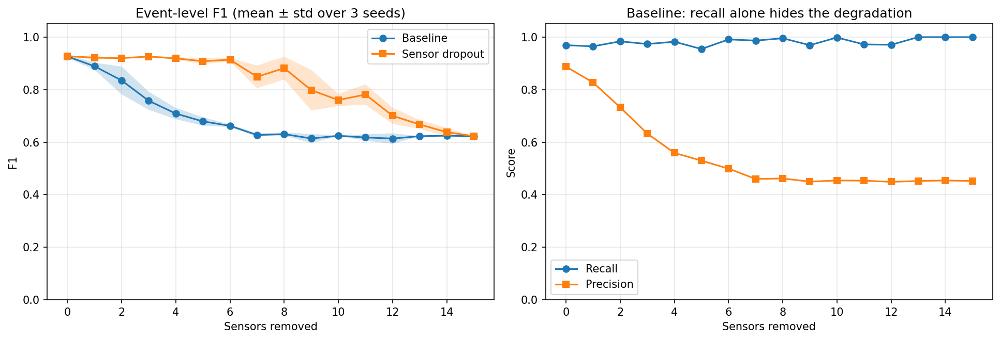

# Sensor-Dropout Training for Robust Fault Detection

**Author:** Gabriel Rozo

Sensors in real wells fail, freeze or are not installed, and the set of available sensors in the 3W Dataset changes from one event class to another (see the overview `dataset/demos/GabrielRozo/main.ipynb`). This benchmark tests a simple idea: train the detector with random sensor masking, so that it does not depend on a few sensors.

## Result

| Sensors removed | Baseline F1 | Sensor-dropout F1 |
|---|---|---|
| 0 | 0.927 ± 0.006 | 0.928 ± 0.002 |
| 4 | 0.709 ± 0.022 | 0.919 ± 0.005 |
| 6 | 0.662 ± 0.005 | 0.914 ± 0.007 |
| 10 | 0.624 ± 0.001 | 0.761 ± 0.023 |
| 15 | 0.623 ± 0.000 | 0.623 ± 0.000 |

Mean ± standard deviation over 3 seeds, scored at the event level on 168 real test events. With all sensors, both detectors perform the same; as sensors go missing, the sensor-dropout detector degrades much more slowly.

## Setup

- **Task:** real events, normal (class 0) vs. any fault (classes 1 to 9), split into train and test sets by event.
- **Features:** windows of 128 samples with statistical features per sensor. Features from the `state` column are removed because that column is the label.
- **Models:** Random Forests. The sensor-dropout model replaces each sensor's features by their training mean with probability 0.25 during training.
- **Sensor loss at test time:** the features of the removed sensors are replaced by their training means.

## How to run

Open `main.ipynb` and run all cells. The full run takes about 25 minutes on a laptop CPU. To rebuild only the figure and the table, run the last code cell, which reads `results.npz`.

Tested with ThreeWToolkit 3.2.1 and 3W Dataset 2.0.0.

## Files

- `main.ipynb`: the full study.
- `results.npz`: scores for every seed and number of removed sensors.
- `robustness_f1.png`: the figure above.