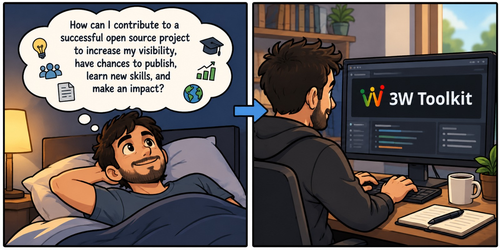
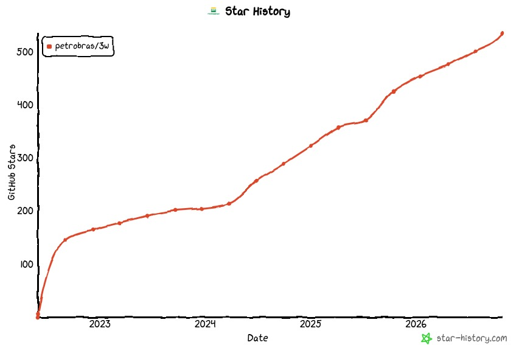

[November 17th, 2026] ~ 35 minutes

# Introduction to 3W Toolkit 3.2.1

1. [Examples](#examples)
2. [Demos](#demos)
3. [Contributing](#contributing)
4. [Quality checks](#quality-checks)
5. [Agent skills](#agent-skills)
6. [What is coming next](#next)

---

The first session, [Architecture and installation](01_architecture_and_installation.md), covered four ideas used throughout this one:

1. A component is a config plus a class: `SomeConfig(...).build()`.
2. Components exchange a `DatasetOutputs` with `signal`, `label` and `metadata`.
3. `transform` returns a new `DatasetOutputs` and leaves its input unchanged.
4. Install from PyPI with `uv pip install ThreeWToolkit`, or clone (or fork) and run `uv sync --locked`.

This session shows how little code a task takes in v.3.2.1, and how a change reaches the toolkit.

---

<a id="examples"></a>

## 🧪 Examples

Every example below uses classes added since the 2.0.0 workshop. Run them from the repository root with the environment active. `path="dataset"` points at the 3W Dataset in the clone. If it is missing, the loader downloads it from Figshare first.

### 1️⃣ Config, build, transform

`DatasetOutputs` is new in 3.2.1. Here it wraps a small table written in the session, so this example does not need the 3W Dataset.

```python
import pandas as pd

from ThreeWToolkit.core import DatasetOutputs
from ThreeWToolkit.preprocessing import RenameColumnsConfig

sample = DatasetOutputs(
    signal=pd.DataFrame({"P-PDG": [1.0, 2.0, 3.0]}),
    label=None,
    metadata={"source": "workshop"},
)

step = RenameColumnsConfig(columns_map={"P-PDG": "pressure"}).build()
renamed = step.transform(sample)

print("input columns: ", list(sample.signal.columns))
print("output columns:", list(renamed.signal.columns))
```

```text
input columns:  ['P-PDG']
output columns: ['pressure']
```

- `RenameColumnsConfig` validates the mapping before any work runs.
- `.build()` creates the `RenameColumns` object named in the config's `_target`.
- `transform` returns a new sample. `sample` still has the column `P-PDG`.

Any other time series works the same way: put it in a DataFrame, wrap it in a `DatasetOutputs`, and every step of the toolkit accepts it.

### 2️⃣ Chain preprocessing steps

`CleanSignals` and `SequentialPreprocessingAdapter` are new. `TransformConfig` (also new) applies the chain to a whole dataset: `fit` learns from the data (for example, which columns to drop and the normalization statistics), and `transform` applies it.

```python
from ThreeWToolkit.dataset import ParquetDatasetConfig, TransformConfig
from ThreeWToolkit.preprocessing import (
    CleanSignalsConfig,
    ImputeMissingConfig,
    NormalizeConfig,
    SequentialPreprocessingAdapterConfig,
)

dataset = ParquetDatasetConfig(
    path="dataset", event_type=["real"], target_class=[2]
).build()

processor = TransformConfig(
    pre_processing=SequentialPreprocessingAdapterConfig(
        steps=[
            CleanSignalsConfig(),
            ImputeMissingConfig(strategy="mean"),
            NormalizeConfig(),
        ]
    ),
).build()
processor.fit(dataset)
clean = processor.transform(dataset)

print("instances:", len(dataset))
print("columns before:", dataset[0].signal.shape[1])
print("columns after: ", clean[0].signal.shape[1])
print("missing values after:", int(clean[0].signal.isna().sum().sum()))
```

```text
instances: 22
columns before: 28
columns after:  15
missing values after: 0
```

`CleanSignals` dropped the frozen and mostly empty sensors, imputation filled the gaps, and normalization scaled what was left. `FillLabels` and `RemapClass` join the same list when labels need cleaning.

### 3️⃣ From signals to features

`Windowing` now lives in feature extraction. `ConcatFeatureAdapter` (new) runs several extractors on the same windows and joins their columns into one table.

```python
from ThreeWToolkit.feature_extraction import (
    ConcatFeatureAdapterConfig,
    EWStatisticalConfig,
    SequentialFeatureAdapterConfig,
    StatisticalConfig,
    WindowingConfig,
)

features = TransformConfig(
    pre_processing=SequentialPreprocessingAdapterConfig(
        steps=[CleanSignalsConfig(), ImputeMissingConfig(strategy="mean")]
    ),
    feature_extraction=SequentialFeatureAdapterConfig(
        steps=[
            WindowingConfig(window_size=128),
            ConcatFeatureAdapterConfig(
                steps=[
                    StatisticalConfig(features=["mean", "std"]),
                    EWStatisticalConfig(),
                ]
            ),
        ]
    ),
).build()
features.fit(dataset)
table = features.transform(dataset)[0]

print("raw signal:   ", dataset[0].signal.shape)
print("feature table:", table.signal.shape)
```

```text
raw signal:    (12721, 28)
feature table: (100, 165)
```

One instance with 12,721 time steps becomes 100 windows of 128 steps, each described by 165 features.

Training a model, running the whole experiment from one `PipelineConfig` and plotting an event with `ThreeWChart` are in the [demos](#demos): `08_sklearn_models_examples`, `00_overview` and `14_three_w_chart_example`.

---

<a id="demos"></a>

## 📓 Demos

Each example above has a longer version in [toolkit/demos/](../../toolkit/demos/). The same notebooks are rendered in the [Read the Docs tutorials](https://threewtoolkit.readthedocs.io/en/latest/tutorials/index.html).

| If you want to…                                  | Open                                                                                                                                                                     |
| ------------------------------------------------ | ------------------------------------------------------------------------------------------------------------------------------------------------------------------------ |
| See the whole toolkit in one notebook            | [00_overview.ipynb](../../toolkit/demos/00_overview.ipynb)                                                                                                              |
| Filter the dataset by class, source or file list | [01_dataset_examples.ipynb](../../toolkit/demos/01_dataset_examples.ipynb)                                                                                              |
| Plot series, spectra and data quality            | [02_data_visualization.ipynb](../../toolkit/demos/02_data_visualization.ipynb)                                                                                          |
| Explore an event interactively                   | [14_three_w_chart_example.ipynb](../../toolkit/demos/14_three_w_chart_example.ipynb)                                                                                    |
| Clean and preprocess signals                     | [03_data_cleaning_examples.ipynb](../../toolkit/demos/03_data_cleaning_examples.ipynb), [04_preprocessing_examples.ipynb](../../toolkit/demos/04_preprocessing_examples.ipynb) |
| Extract features                                 | [05_feature_extraction_examples.ipynb](../../toolkit/demos/05_feature_extraction_examples.ipynb)                                                                        |
| Compare real and simulated events by clustering  | [06_clustering_pipeline_examples.ipynb](../../toolkit/demos/06_clustering_pipeline_examples.ipynb), [07_clustering_real_vs_simulated_examples.ipynb](../../toolkit/demos/07_clustering_real_vs_simulated_examples.ipynb) |
| Train scikit-learn models with a confusion matrix | [08_sklearn_models_examples.ipynb](../../toolkit/demos/08_sklearn_models_examples.ipynb)                                                                               |
| Train an MLP on time series                      | [09_mlp_timeseries_example.ipynb](../../toolkit/demos/09_mlp_timeseries_example.ipynb)                                                                                  |
| Save and load a trained model                    | [10_load_save_model_examples.ipynb](../../toolkit/demos/10_load_save_model_examples.ipynb)                                                                              |
| Evaluate a model and compute metrics             | [11_assessment_examples.ipynb](../../toolkit/demos/11_assessment_examples.ipynb), [12_using_metrics.ipynb](../../toolkit/demos/12_using_metrics.ipynb)                  |
| Generate an HTML or LaTeX report                 | [13_report_generation_examples.ipynb](../../toolkit/demos/13_report_generation_examples.ipynb)                                                                          |

Good starting points for this session: `00_overview` for the full flow, `08_sklearn_models_examples` for a complete classifier, and `07_clustering_real_vs_simulated_examples` for what clustering adds.

---

<a id="contributing"></a>

## 🤝 Contributing



Open-source projects grow through collaboration, and the 3W project is no exception. Whether you are an experienced developer, a researcher, a student, or just getting started with programming, there is a place for you to contribute!

Contributions come in many forms and at different levels of complexity:

- **Getting started:** Improve documentation, fix typos, report bugs, share feedback, or suggest new features.
- **Sharing knowledge:** Contribute tutorials, examples, dataset overviews, and practical use cases.
- **Developing solutions:** Improve existing code, implement new features, add preprocessing methods, or develop new models and tools.

Every contribution, no matter its size, helps make the project better and more useful for the entire community.

### 🌟 Join the community



The rules come from three files. This section summarizes them:

- [CONTRIBUTING.md](../../CONTRIBUTING.md): every kind of contribution (dataset, overviews, documentation, toolkit).
- [3W_TOOLKIT_CONTRIBUTING.md](../../3W_TOOLKIT_CONTRIBUTING.md): toolkit code, with step-by-step guides for a new model, preprocessing step, feature extractor, trainer or assessment.
- [AGENTS.md](../../AGENTS.md): the same rules in short form, written for coding agents and useful for people too.

### 📋 Before the first pull request

- Read and accept the [Code of Conduct](../../CODE_OF_CONDUCT.md) and the [Contributor License Agreement](../../CONTRIBUTOR_LICENSE_AGREEMENT.md). The pull request form asks you to confirm the individual or the corporate CLA.
- Questions go to [GitHub Discussions](https://github.com/petrobras/3W/discussions). Issues are for bugs and proposed changes.
- For a larger change, check the [backlog](../../BACKLOG.md) and say in Discussions that you are taking it.

### 🎯 What you can contribute

| Contribution                          | Where it goes                         |
| ------------------------------------- | ------------------------------------- |
| A bug report                          | An issue                              |
| A bug fix, a new toolkit component    | `toolkit/ThreeWToolkit/` and `tests/` |
| A toolkit demo                        | `toolkit/demos/NN_topic.ipynb`        |
| A 3W Dataset overview                 | `dataset/demos/<your_name>/main.ipynb` |
| A tutorial or course material         | `resources/<topic>/`                  |
| A complete benchmark                  | `benchmarks/<name>/`                  |
| A documentation improvement           | The Markdown files or `toolkit/docs/` |

### 🔀 Fork, branch, pull request

Every pull request comes from a fork (see [Change the toolkit from a fork](01_architecture_and_installation.md#-change-the-toolkit-from-a-fork-recommended) in the first session) and targets the **`main`** branch of `petrobras/3W`.

1. Fork `petrobras/3W` on GitHub.
2. Clone your fork.
3. Create a branch from `main`.
4. Write the code and its tests.
5. Run `./bin/lint` and `./bin/test`.
6. Open a pull request into `main`.
7. CI runs and a maintainer reviews it.

```bash
git clone git@github.com:<your-username>/3W.git
cd 3W
git remote add upstream git@github.com:petrobras/3W.git
git fetch upstream
git checkout -b feature/short-name upstream/dev
uv sync --locked --extra dev
```

| Branch              | Use                                                   |
| ------------------- | ----------------------------------------------------- |
| `feature/<name>`    | A new model, preprocessing step or feature extractor  |
| `bugfix/<name>`     | A fix                                                 |
| `docs/<name>`       | Documentation                                         |
| `refactor/<name>`   | A restructure with the same behavior                  |

One pull request, one change. Commit messages follow [Conventional Commits](https://www.conventionalcommits.org/):

```text
feat(preprocessing): add a clip step for sensor ranges

Clip each signal column to the bounds declared on the config.
```

Common types are `feat`, `fix`, `docs`, `test`, `refactor` and `chore`. The scope is the submodule.

### 🧩 Adding a component in practice

A new preprocessing step touches three files: the component, the submodule's `__init__.py` and a test file. The example below adds `ClipSignals`, which clips every column to a range.

**1. The component: `toolkit/ThreeWToolkit/preprocessing/clip_signals.py`**

The config comes first, then the class, in the same file. Every parameter is a `Field` with a description, and checks live in a `field_validator`.

```python
from pydantic import Field, PrivateAttr, ValidationInfo, field_validator

from ..core.base_preprocessing import BasePreprocessing, BasePreprocessingConfig
from ..core.dataset_outputs import DatasetOutputs


class ClipSignalsConfig(BasePreprocessingConfig):
    """Configuration for clipping every signal column to a range."""

    lower: float = Field(..., description="Lower bound for every column.")
    upper: float = Field(..., description="Upper bound for every column.")

    _target: type = PrivateAttr(default_factory=lambda: ClipSignals)

    @field_validator("upper")
    @classmethod
    def check_bounds(cls, upper: float, info: ValidationInfo) -> float:
        lower = info.data.get("lower")
        if lower is not None and upper <= lower:
            raise ValueError("upper must be greater than lower")
        return upper


class ClipSignals(BasePreprocessing):
    """Clip every signal column to the bounds in the config."""

    def __init__(self, config: ClipSignalsConfig):
        self.config = config

    def transform(self, data: DatasetOutputs) -> DatasetOutputs:
        signal = data.signal.clip(self.config.lower, self.config.upper)
        return data.model_copy(update={"signal": signal})
```

`transform` builds a new `DatasetOutputs` with `model_copy`, so the input is never modified. `fit` is inherited and does nothing, because clipping learns nothing from the data.

**2. The export: `toolkit/ThreeWToolkit/preprocessing/__init__.py`**

Import the two classes and add them to `__all__`, so users can write `from ThreeWToolkit.preprocessing import ClipSignalsConfig`:

```python
from .impute_missing import ImputeMissingConfig, ImputeMissing
from .normalize import NormalizeConfig, Normalize

# ... the other existing imports ...
from .clip_signals import ClipSignalsConfig, ClipSignals

__all__ = [
    "ImputeMissingConfig",
    "ImputeMissing",
    # ... the other existing names ...
    "ClipSignalsConfig",
    "ClipSignals",
]
```

**3. The tests: `tests/preprocessing/test_clip_signals.py`**

Tests are grouped in a class. The `mock_dataset_factory` fixture from `tests/conftest.py` builds a synthetic dataset (sensor columns named `sensor_0`, `sensor_1`, ...) with the size, mean, standard deviation and fraction of missing values you ask for, so the tests do not need the 3W Dataset.

```python
"""Tests for ClipSignals preprocessing class."""

import pandas as pd
import pytest

from ThreeWToolkit.core.dataset_outputs import DatasetOutputs
from ThreeWToolkit.dataset import ParquetDatasetConfig
from ThreeWToolkit.preprocessing import ClipSignalsConfig


class TestClipSignals:
    """Test config validation and clipping behavior."""

    def test_rejects_inverted_bounds(self):
        with pytest.raises(ValueError):
            ClipSignalsConfig(lower=10.0, upper=0.0)

    def test_values_stay_within_bounds(self, mock_dataset_factory):
        dataset = mock_dataset_factory(num_events=3, global_mean=50.0, global_std=15.0)
        step = ClipSignalsConfig(lower=40.0, upper=60.0).build()

        for event in dataset:
            out = step.transform(event)
            assert out.signal.min().min() >= 40.0
            assert out.signal.max().max() <= 60.0

    def test_input_is_not_modified(self, mock_dataset_factory):
        event = mock_dataset_factory(num_events=1)[0]
        before = event.signal.copy()

        ClipSignalsConfig(lower=40.0, upper=60.0).build().transform(event)

        pd.testing.assert_frame_equal(event.signal, before)

    def test_nan_values_are_kept(self, mock_dataset_factory):
        event = mock_dataset_factory(num_events=1, nan_row_rate=0.2)[0]

        out = ClipSignalsConfig(lower=40.0, upper=60.0).build().transform(event)

        assert out.signal.isna().equals(event.signal.isna())

    def test_empty_signal(self):
        event = DatasetOutputs(signal=pd.DataFrame(), label=None)

        out = ClipSignalsConfig(lower=0.0, upper=1.0).build().transform(event)

        assert out.signal.empty


@pytest.mark.slow
class TestClipSignalsOnRealData:
    """Tests that read the real 3W Parquet files."""

    def test_real_instance(self):
        dataset = ParquetDatasetConfig(path="dataset", target_class=[1]).build()
        step = ClipSignalsConfig(lower=0.0, upper=1e7).build()

        out = step.transform(dataset[0])

        assert out.signal.shape == dataset[0].signal.shape
```

The five tests in `TestClipSignals` cover what every component needs: config validation, the behavior, edge cases (NaN and empty input) and an unchanged input. `TestClipSignalsOnRealData` reads `dataset/`, so it is marked `@pytest.mark.slow`: CI checks out the repository without the Parquet files, and `./bin/test` skips `slow` tests unless `RUN_SLOW_TESTS=1` is set.

Run only these tests while you work:

```bash
pytest tests/preprocessing/test_clip_signals.py -v
```

The full guide, with a template for each kind of component, is [How to Contribute](../../3W_TOOLKIT_CONTRIBUTING.md#how-to-contribute). The base class to start from and a file to copy for each kind are in the [add-toolkit-component](../../.agents/skills/add-toolkit-component/SKILL.md) skill.

### ✅ Before opening the pull request

- `./bin/lint` and `./bin/test` pass (next section).
- New behavior has tests. Docstrings are in English, Google style.
- The description follows the [pull request template](../../.github/pull_request_template.md) and confirms the CLA.

---

<a id="quality-checks"></a>

## 🔍 Quality checks

The scripts in [bin/](../../bin/) are the same checks CI runs. Run them from the repository root after `uv sync --locked --extra dev`:

```bash
CI=false ./bin/lint
./bin/test
```

| Command                                     | What it does                                                                                          |
| ------------------------------------------- | ----------------------------------------------------------------------------------------------------- |
| `CI=false ./bin/lint`                       | Local mode: mypy, then `ruff check --fix`. Also checks links with `lychee` when it is installed.       |
| `./bin/lint`                                | CI mode: the same checks, without auto-fix.                                                           |
| `./bin/test`                                | pytest with coverage. Skips tests marked `slow`.                                                      |
| `RUN_SLOW_TESTS=1 ./bin/test`               | Also runs the tests that read the real Parquet files.                                                 |
| `pytest tests/preprocessing/test_normalize.py -k l2` | One file or one test while you work.                                                         |
| `./bin/nb_test`                             | Executes the demo notebooks in `toolkit/demos/` and `dataset/demos/_basic/`. Slow, and not run by CI. |
| `./bin/sync_agent_files`                    | Copies the agent skills to `.claude/skills/`. CI runs it with `--check`.                               |

What CI runs on each push ([tests.yml](../../.github/workflows/tests.yml)):

- **Lint** on Python 3.12: `./bin/lint` and `./bin/sync_agent_files --check`.
- **Tests** on Python 3.10, 3.11 and 3.12: `./bin/test`.

Both install with `uv sync --locked --extra dev`, and the checkout has no Parquet files. A test that silently depends on `dataset/` passes locally and fails in CI.

Run `./bin/nb_test` when a change touches a notebook or a class the demos import. Those notebooks are part of what the project keeps working across releases.

---

<a id="agent-skills"></a>

## 🤖 Agent skills

The repository is prepared for coding agents (Claude Code, GitHub Copilot, Cursor, Codex, Gemini). [AGENTS.md](../../AGENTS.md) holds the project rules: layout, commands, architecture conventions, testing and dataset rules. Agents read it automatically. `GEMINI.md` points to it.

For recurring tasks there are skills: short, step-by-step guides an agent loads when the task matches.

| Skill                                                                       | Use it to                                                                          |
| --------------------------------------------------------------------------- | ---------------------------------------------------------------------------------- |
| [add-toolkit-component](../../.agents/skills/add-toolkit-component/SKILL.md) | Add a preprocessing step, feature extractor, model, metric or plot with config, tests and docs |
| [run-quality-checks](../../.agents/skills/run-quality-checks/SKILL.md)       | Run and fix lint, tests and notebook checks the way CI does                        |
| [load-3w-dataset](../../.agents/skills/load-3w-dataset/SKILL.md)             | Load, filter and inspect 3W instances                                              |
| [add-demo-notebook](../../.agents/skills/add-demo-notebook/SKILL.md)         | Put a new notebook in the right folder so it keeps running                         |

With an agent, a contribution can start from one sentence, for example: *"Add a ClipSignals preprocessing step that clips every column to a lower and upper bound, following the add-toolkit-component skill, then run the quality checks."* The agent follows the skill, writes the config, the class, the export and the tests, and runs `./bin/lint` and `./bin/test`. Review the result like any other pull request.

Skills are edited only in `.agents/skills/`. `.claude/skills/` is a generated copy: after changing a skill, run `./bin/sync_agent_files` and commit both.

The skills are also a short reference for people: each one is the checklist a maintainer would give you.

---

<a id="next"></a>

## 🔭 What is coming next

The list we work from is [BACKLOG.md](../../BACKLOG.md). Still ahead:

- Benchmarks so two solutions can be compared on the same task.
- A shared way to validate a model on those benchmarks.
- Hyperparameter search.
- Time-aware metrics for detection and classification.
- A tool that shows the difference between two versions of the 3W Dataset.

A first contribution can be a small preprocessing or feature step that follows the `add-toolkit-component` skill, with tests, in a pull request to `dev`. Issues labeled as a good first issue are a starting point.

---

| | |
|--|--|
| Documentation | https://threewtoolkit.readthedocs.io/en/latest/ |
| Install | `uv pip install ThreeWToolkit` |
| Examples | [toolkit/demos/](../../toolkit/demos/) |
| Questions | https://github.com/petrobras/3W/discussions |

Previous session: [Architecture and installation](01_architecture_and_installation.md).
