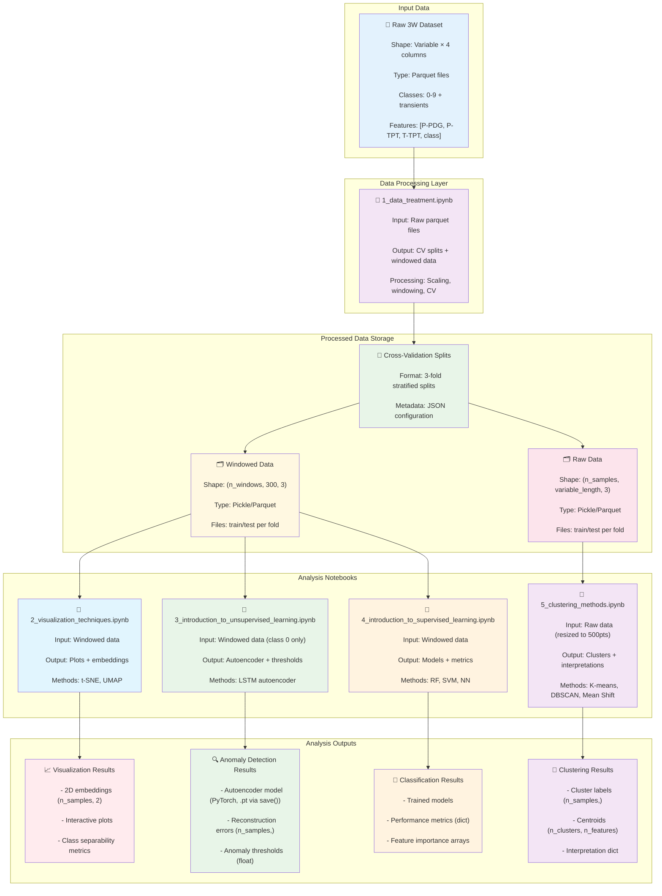
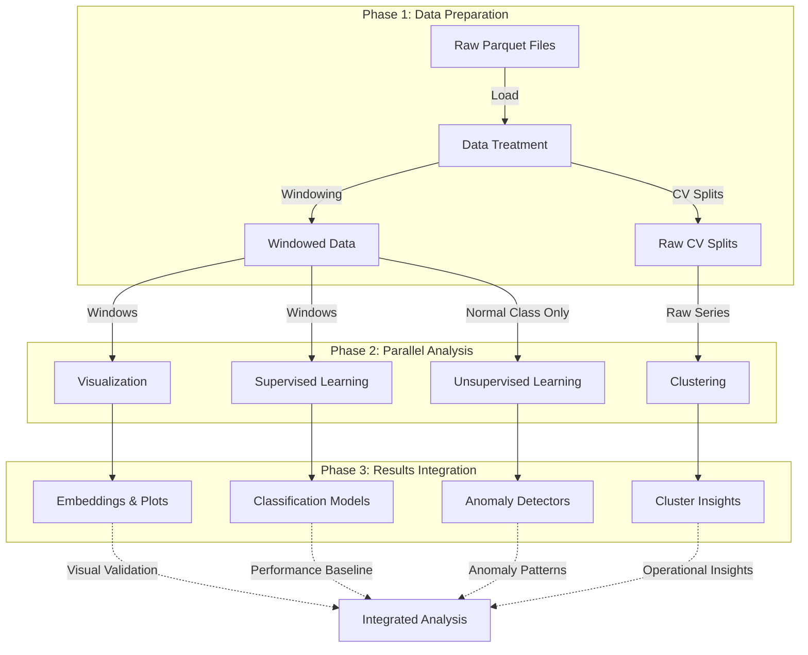

# Introduction to Machine Learning applied to Multivariate Time Series

## 🎯 Overview

This resource contains a comprehensive machine learning pipeline for the **3W Dataset** - a real-world dataset for fault detection in oil wells. The pipeline includes data preprocessing, supervised learning, unsupervised learning, and clustering analysis methods applied to **Multivariate Time Series (MTS)** data.

**🎓 Educational Use**: This resource is designed for educational purposes and can be utilized in **machine learning courses, workshops, tutorials, and academic programs** focusing on time series analysis, fault detection, and industrial applications.

**Multivariate Time Series (MTS)** refers to time-ordered data with multiple variables/sensors measured simultaneously over time. In the 3W dataset context, this includes multiple sensor readings (pressure, temperature, flow rates, etc.) from oil well operations captured at regular intervals.


## 🎬 Workshop Presentation

The material in this notebook was presented at the **4th Workshop on 3W** (Days 2 and 3). A full recording of the session is available on YouTube:

**[▶ Watch the workshop recording Part #1](https://www.youtube.com/watch?v=0ugu1piqtxc&list=PLrdqjADUU50kf0kjnM-JngcyU0mEFL6U1)**
**[▶ Watch the workshop recording Part #2](https://www.youtube.com/watch?v=o5KZyREfPKs&list=PLrdqjADUU50kf0kjnM-JngcyU0mEFL6U1)**

🗒️ Presenting or teaching this material? [`Presentation.md`](Presentation.md) is a speaker guide (in Portuguese) with an agenda, talking points for each notebook, a demo checklist and fallbacks.

## 📖 Companion Book

This resource is the practical companion of the book:

> Lopes, L. G. O.; Vieira, T. M. A.; Lima Junior, E. T.; Lira, W. W. M.; Aranha, P. E.; Vargas, R. E. V. (2026). **Aprendizado de Mundo Aberto em Poços de Petróleo: da detecção baseada em regras à explicabilidade por agentes de linguagem.** Maceió: Laboratório de Computação Científica e Visualização, Universidade Federal de Alagoas. ISBN 978-65-02-28836-8. DOI: [10.5281/zenodo.22306796](https://doi.org/10.5281/zenodo.22306796). Licensed under CC BY 4.0.

The book (in Portuguese) tells how the detection, segmentation and explanation of undesirable events in oil wells was attacked by successive approximations, over several years. **Appendix E** ("Roteiro prático com o repositório 3W") uses this resource as an executable learning path for the concepts of Part I of the book, and each notebook points to the chapters that give its theoretical background:

| Notebook | Book chapters exercised |
|---|---|
| `1_data_treatment` | Ch. 3 — the 3W dataset, pitfalls, preprocessing (windowing, scaling) — and Ch. 4 — validation |
| `2_visualization_techniques` | Chs. 3 and 6 — t-SNE, UMAP and the caveats on projections |
| `3_introduction_to_unsupervised_learning` | Chs. 5, 6 and 7 — LSTM autoencoder, reconstruction-error threshold, one-class SVM |
| `4_introduction_to_supervised_learning` | Chs. 4 and 8 — trees, SVM, MLP and evaluation metrics |
| `5_clustering_methods` | Chs. 6 and 9 — K-means, DBSCAN, MeanShift, silhouette, adjusted Rand index |

**This resource is a learning path, not a reproduction of the book's experiments** (those are described in the book's Appendix D). Its settings are deliberately reduced to fit the time of a class; the main differences are:

| Aspect | This resource | Book |
|---|---|---|
| Sensors | 3 (`P-PDG`, `P-TPT`, `T-TPT`) | 4 or 5, depending on the chapter |
| Window | 300 points, subsampled 1:5 (covers 1500 s) | 200 to 500 points at the original frequency |
| Instances per class | Up to 50 files | All available |
| Partition | 3 folds, split by instance; training with real + simulated (+ drawn) events, test with real events only | Temporal 80/20 split; simulated events only for classes with few real instances; drawn events never used |
| Autoencoder latent space | 16 to 32 dimensions, 64 LSTM units | 4 to 128 dimensions, depending on the chapter |
| Classes | Subset `{0, 3, 4, 8}` in the supervised notebook | All ten |

Each difference is a decision you can reverse by editing `src/config.py` and re-running — measuring the effect of each one teaches more than any table of ready-made results. Every notebook ends with the guided exercises proposed in Appendix E.

If you use this material in your work, please cite the book (BibTeX below) and the [3W Project](../../README.md).

```bibtex
@book{lopes2026mundoaberto,
  author    = {Lopes, Lucas Gouveia Omena and Vieira, Thales Miranda de Almeida and Lima Junior, Eduardo Toledo de and Lira, William Wagner Matos and Aranha, Pedro Esteves and Vargas, Ricardo Emanuel Vaz},
  title     = {Aprendizado de Mundo Aberto em Po{\c{c}}os de Petr{\'o}leo: da detec{\c{c}}{\~a}o baseada em regras {\`a} explicabilidade por agentes de linguagem},
  year      = {2026},
  publisher = {Laborat{\'o}rio de Computa{\c{c}}{\~a}o Cient{\'i}fica e Visualiza{\c{c}}{\~a}o, Universidade Federal de Alagoas},
  address   = {Macei{\'o}},
  isbn      = {978-65-02-28836-8},
  doi       = {10.5281/zenodo.22306796}
}
```

## 🧰 Relationship with the 3W Toolkit

The [3W Toolkit](../../toolkit/ThreeWToolkit/README.md) is now the official package of the project, so this resource reuses it wherever the results do not change, instead of reinventing the wheel:

| Used from `ThreeWToolkit` | Where |
|---|---|
| `dataset.ParquetDataset` / `ParquetDatasetConfig` — file discovery, provenance (`real`, `simulated`, `drawn`) and reading | `src/data_loader.py` |
| `metrics.accuracy_score` and `metrics.balanced_accuracy_score` | `src/supervised_classification.py` |
| `data_visualization.CorrelationHeatmap` | `src/visualization.py` |

The following stay local to `src/` on purpose, because the toolkit equivalent would change the results or does not offer the same behavior:

| Local component | Toolkit counterpart | Why it stays |
|---|---|---|
| Scaling (`minmax`, `standard`, `robust`, `normalizer`) | `preprocessing.Normalize` (L1/L2/max norms) | Different transformations |
| `DataPreprocessor.create_time_windows` | `feature_extraction.Windowing` | The workshop windowing returns one dataframe per window with metadata and allows `min_window_size < window_size`; the toolkit (by default) pads the start of the signal, takes fractional overlaps and returns a multi-indexed dataframe |
| Missing-value filling in `DataLoader` | `preprocessing.ImputeMissing` | `ImputeMissing` raises an error when a sensor is entirely missing in an event, and sensors absent from an event are frequent in 3W |
| `CrossValidator` (real/simulated-aware folds) | `utils.KFoldSplitter` | The toolkit splitter works on `BaseDataset` objects and has no notion of "train with simulated, test only with real" |
| Resizing to 500 points (clustering) | `clustering.TimeSeriesResampler` | The toolkit resampler slices or averages by a step size and keeps variable lengths |
| t-SNE/UMAP, K-means/MeanShift/DBSCAN suite, data augmentation, one-class SVM | — | Not offered by the toolkit |
| LSTM autoencoder (PyTorch) | `models.MLP`, `trainer.TorchTrainer` | No recurrent autoencoder in the toolkit |

To go further with the toolkit itself, follow the [Introduction to 3WToolkit v2.0.0](../introduction_to_3w_toolkit_v2.0.0/README.md) tutorials. The toolkit also has a `clustering` sub-package for instance-level clustering of time series; see its [demos](../../toolkit/demos/).

> **ℹ️ Versions**: the dataset is read by `ThreeWToolkit.dataset.ParquetDataset`, which expects the 3W Dataset **2.0.0** in `../../dataset/` (it is downloaded from Figshare when missing).

## ⚠️ **Configuration Disclaimer**

> **📋 Important Note**: All configurations shown in this documentation (sensor variables, data shapes, window sizes, etc.) are **examples for demonstration purposes**. The pipeline is **fully configurable** and can be adapted to:
> - **Any sensor combination** (P-TPT, T-TPT are just examples)
> - **Variable window sizes** (300 points is configurable)
> - **Different feature counts** (shapes shown are examples)
> - **Custom preprocessing methods** (scaling, windowing, etc.)
> 
> **🔧 Customization**: Modify `src/config.py` to adapt the pipeline to your specific requirements. The current configuration is optimized for workshop presentation time constraints.

## 📊 Notebooks Architecture & Data Contracts




## 📋 Usage Instructions

### Prerequisites

For all results generated by this ML pipeline to be **consistent**, we recommend creating and using a virtual environment with the dependencies specified in the project's [pyproject.toml](../../pyproject.toml). Our recommended virtual environment manager is [uv](https://docs.astral.sh/uv/). Install `uv` according to the [official instructions](https://docs.astral.sh/uv/getting-started/installation/).

**🔧 Step-by-Step Setup Instructions:**

1. **Create and activate the virtual environment:**

   **Linux / macOS (terminal):**
   ```bash
   uv venv .venv
   source .venv/bin/activate
   uv pip install -e ../../.
   jupyter notebook
   ```

   **Windows (cmd):**
   ```cmd
   uv venv .venv
   .venv\Scripts\activate.bat
   uv pip install -e ../../.
   jupyter notebook
   ```

   **Windows (PowerShell):**
   ```powershell
   uv venv .venv
   .venv\Scripts\Activate.ps1
   uv pip install -e ../../.
   jupyter notebook
   ```

   **Windows (Bash):**
   ```bash
   uv venv .venv
   source .venv/Scripts/activate
   uv pip install -e ../../.
   jupyter notebook
   ```

> **📋 Environment Notes**: 
> - All package dependencies are managed centrally via the project's `pyproject.toml`. The workshop code uses the installed [3W Toolkit](../../toolkit/ThreeWToolkit/README.md) (`ThreeWToolkit`); see the toolkit's [installation guide](../introduction_to_3w_toolkit_v2.0.0/2_installation.ipynb) for other installation methods.
> - Notebook 2 (UMAP) needs the optional `resources` extra. Use `uv pip install -e "../../.[resources]"` instead of the install line above (or run it afterwards).
> - TensorFlow is **not** required: the LSTM autoencoder of notebook 3 is written in PyTorch, the same framework used by the toolkit.
> - The 3W Dataset 2.0.0 is expected in `../../dataset/`; if it is missing, `ParquetDataset` downloads it from Figshare on first use.

### Execution Order
1. **Start with Data Treatment**: Run `1_data_treatment.ipynb` first to prepare MTS data
2. **Parallel Analysis**: Run notebooks 2-5 in any order (they're independent)
3. **Configuration**: Modify `src/config.py` for different MTS parameters

### Quick Start
```python
# Verify data preparation
from src.data_persistence import DataPersistence
from src import config

persistence = DataPersistence(base_dir=config.PROCESSED_DATA_DIR)
print(f"Windowed data available: {persistence.check_windowed_data()}")
print(f"Raw data available: {persistence.check_raw_data()}")
```

### 🔍 Troubleshooting Navigation

**Finding the correct directory path:**
```bash
# Windows - Find your 3W repository location
dir /s pyproject.toml

# Linux/macOS - Find your 3W repository location  
find ~ -name "pyproject.toml" -type f 2>/dev/null | grep 3W
```

**Verify you're in the correct directory:**
```bash
# You should see these files when you run:
ls          # Linux/macOS
dir         # Windows

# Expected output should include:
# - README.md  
# - src/
# - 1_data_treatment.ipynb
# - 2_visualization_techniques.ipynb
# - etc.
```

**Common path examples:**
```bash
# Windows examples:
cd "C:\Users\YourUsername\Documents\GitHub\3W\resources\introduction_to_ml_applied_to_mts"
cd "D:\Projects\3W\resources\introduction_to_ml_applied_to_mts"

# Linux/macOS examples:  
cd ~/Documents/3W/resources/introduction_to_ml_applied_to_mts
cd ~/Projects/3W/resources/introduction_to_ml_applied_to_mts
```

## 🔧 Configuration

All pipeline parameters are centralized in `src/config.py`:

```python
# Key Configuration Parameters
TARGET_FEATURES = ['P-PDG', 'P-TPT', 'T-TPT', 'class']
NON_REAL_EVENT_TYPES = ['simulated', 'drawn']  # loaded after the real events, up to MAX_FILES_PER_CLASS
MAX_FILES_PER_CLASS = 50
SAMPLING_RATE = 5       # keeps one row in five: a 300-point window covers 1500 s
WINDOW_SIZE = 300
WINDOW_STRIDE = 150     # 50% overlap
N_FOLDS = 3
DEFAULT_SCALING_METHOD = 'minmax'
RANDOM_SEED = 42
```

> **Three parameters change the nature of the experiment** (see Appendix E of the [companion book](#-companion-book)): `SAMPLING_RATE` (compare with the book by the *time covered* by a window, not by its number of points), `WINDOW_STRIDE` (overlapping windows are harmless here only because folds are split by instance, not by window) and `NON_REAL_EVENT_TYPES` (use `['simulated']` to exclude hand-drawn events, closer to the book's protocol). `MAX_FILES_PER_CLASS` controls memory usage: it is the first one to reduce if notebook 1 fails.

## 📈 Expected Outputs

### Performance Metrics
- **Classification**: Accuracy and balanced accuracy per fold and model (the latter is the metric recommended by the book under class imbalance)
- **Novelty Detection**: Detection rate, false alarm rate, ROC AUC
- **Clustering**: Silhouette score, adjusted Rand index, clustering accuracy (Hungarian assignment)
- **Visualization**: Cluster separability, dimensionality reduction quality

### File Structure After Execution
```
processed_data/
├── cv_splits/
│   ├── windowed/
│   │   ├── fold_1/
│   │   │   ├── train_windowed.pickle
│   │   │   ├── test_windowed.pickle
│   │   │   └── windowing_metadata.json
│   │   ├── fold_2/
│   │   └── fold_3/
│   └── raw/
│       ├── fold_1/
│       │   ├── train_data.pickle
│       │   ├── test_data.pickle
│       │   └── fold_metadata.json
│       ├── fold_2/
│       └── fold_3/
└── metadata/
    ├── scaling_metadata.json
    └── cv_metadata.json
```


## 🚀 Advanced Usage

### Custom Configurations
- Modify window sizes and overlap in `src/config.py` for different MTS analysis needs
- Adjust cross-validation parameters for different temporal splits
- Experiment with different scaling methods for multivariate data
- Customize clustering parameters and algorithms for time series patterns

### Extension Points
- Add new classification algorithms suitable for multivariate time series
- Implement additional clustering methods for temporal pattern discovery
- Extend visualization techniques for multivariate time series analysis
- Develop custom novelty detection approaches for specific MTS applications

## 📝 Notes

- **Data Dependencies**: Notebook 1 must be run before others to prepare MTS data
- **Memory Requirements**: Large multivariate time series datasets may require sampling
- **Execution Time**: With the default configuration the whole pipeline takes about 10-15 minutes on an 8-thread CPU; increasing `MAX_FILES_PER_CLASS` or lowering `SAMPLING_RATE` makes it much longer
- **Reproducibility**: Random seeds are set (`RANDOM_SEED = 42`), including the window sampling of notebook 3, so repeated executions give the same numbers on the same dataset and package versions


## 📚 Notebook Pipeline Description

### 1️⃣ **Data Treatment** (`1_data_treatment.ipynb`)
**Purpose**: Foundation preprocessing and data preparation for MTS analysis
- **Input**: Raw 3W dataset (`dataset/0-9/*.parquet`)
- **Processing**:
  - Centralized configuration management
  - Multiple scaling methods comparison for time series
  - Smart cross-validation with real/simulated separation
  - Time windowing for sequence models
- **Output**: 
  - `processed_data/cv_splits/windowed/` - Windowed multivariate time series
  - `processed_data/cv_splits/raw/` - Raw time series with CV splits
  - Configuration metadata and preprocessing parameters

### 2️⃣ **Visualization Techniques** (`2_visualization_techniques.ipynb`)
**Purpose**: Exploratory data analysis and dimensionality reduction for MTS
- **Input**: Windowed data from `processed_data/cv_splits/windowed/`
- **Processing**:
  - Advanced dimensionality reduction (t-SNE, UMAP) for time series
  - Class mapping and balanced sampling
  - Interactive dashboards and statistical insights
- **Output**: 
  - Interactive visualizations of multivariate patterns
  - Feature correlation analysis across time series
  - Class separability insights in reduced space

### 3️⃣ **Unsupervised Learning** (`3_introduction_to_unsupervised_learning.ipynb`)
**Purpose**: Novelty detection and anomaly identification in MTS
- **Input**: Windowed data from `processed_data/cv_splits/windowed/`
- **Processing**:
  - LSTM autoencoder training on normal multivariate sequences (class 0)
  - Reconstruction-based anomaly detection for time series
  - Statistical threshold determination for temporal patterns
- **Output**:
  - Novelty detection models for multivariate time series
  - Anomaly scores and thresholds for temporal deviations
  - Detection performance metrics for MTS anomalies

### 4️⃣ **Supervised Learning** (`4_introduction_to_supervised_learning.ipynb`)
**Purpose**: Multi-class fault classification in multivariate time series
- **Input**: Windowed data from `processed_data/cv_splits/windowed/`
- **Processing**:
  - Classification algorithms adapted for time series (Random Forest, SVM, Neural Networks)
  - Cross-validation evaluation with temporal considerations
  - Performance metrics and comparison for MTS classification
- **Output**:
  - Trained classification models for fault detection
  - Performance benchmarks for multivariate time series
  - Feature importance analysis across sensors and time
  
### 5️⃣ **Clustering Methods** (`5_clustering_methods.ipynb`)
**Purpose**: Pattern discovery and operational insights in multivariate time series
- **Input**: Raw data from `processed_data/cv_splits/raw/`
- **Processing**:
  - K-means clustering with elbow method for MTS patterns
  - Density-based clustering (DBSCAN, Mean Shift) for temporal clusters
  - Cluster interpretation and validation for operational states
- **Output**:
  - Cluster assignments and centroids for multivariate patterns
  - Operational pattern insights from time series clustering
  - Clustering quality metrics for MTS data

## 🔄 Data Flow & Dependencies

### Pipeline Execution Graph


### Data Transformation Pipeline
```python
# Step-by-step data transformations

# 1. Raw Data → Data Treatment
raw_data = load_parquet_files()              # Shape: (variable, 4) -> P-PDG, P-TPT, T-TPT, class
scaled_data = apply_scaling(raw_data)        # Shape: (variable, 4) 
windowed_data = create_windows(scaled_data)  # Shape: (n_windows, 300, 3)
cv_splits = stratified_split(windowed_data)  # 3 folds

# 2. Windowed Data → Analysis Notebooks
# Notebook 2: Visualization
flattened = flatten_windows(windowed_data)   # Shape: (n_windows, 900)
embeddings = reduce_dimensions(flattened)    # Shape: (n_windows, 2)

# 3: Unsupervised Learning
normal_data = filter_class_0(windowed_data)  # Shape: (n_normal, 300, 3)
autoencoder = train_lstm_ae(normal_data)     # torch.nn.Module (PyTorch)

# 4: Supervised Learning  
X_train, y_train = prepare_classification()  # Shape: (n_train, 900), (n_train,)
models = train_classifiers(X_train, y_train) # sklearn estimators

# 5. Raw Data → Clustering Analysis
resized_series = resize_to_500pts(raw_data)  # Shape: (n_samples, 1500)
clusters = apply_clustering(resized_series)  # Shape: (n_samples,)
```

### Memory & Performance Specifications
```python
# Resource requirements and performance characteristics (depends on the max number of files per class loaded on config file)

MEMORY_REQUIREMENTS = {

    "Warning - Notebook 1 depends on the maximum number of files per anomaly"
    "notebook_1": {
        "peak_memory": "4-6 GB (up to 50 files per class)",
        "processing_time": "~1-2 minutes",
        "disk_space": "500 MB - 2 GB"
    },
    "notebook_2": {
        "peak_memory": "2-5 GB", 
        "processing_time": "~1-2 minutes",
        "output_size": "10-50 MB"
    },
    "notebook_3": {
        "peak_memory": "2-5 GB",
        "processing_time": "~4-6 minutes", 
        "model_size": "1-100 MB"
    },
    "notebook_4": {
        "peak_memory": "2-5 GB",
        "processing_time": "~3 minutes",
        "model_size": "10-200 MB"
    },
    "notebook_5": {
        "peak_memory": "2-5 GB",
        "processing_time": "< 1 minute",
        "output_size": "5-20 MB"
    }
}

# Processing times were measured with the default configuration on an 8-thread CPU
# (no GPU); slower machines can take considerably longer.

DATA_VOLUME_SCALING = {
    "small_dataset": "< 1000 samples per class",
    "medium_dataset": "1000-10000 samples per class", 
    "large_dataset": "> 10000 samples per class",
    "memory_scaling": "O(n_samples × window_size × n_features)"
}
```

