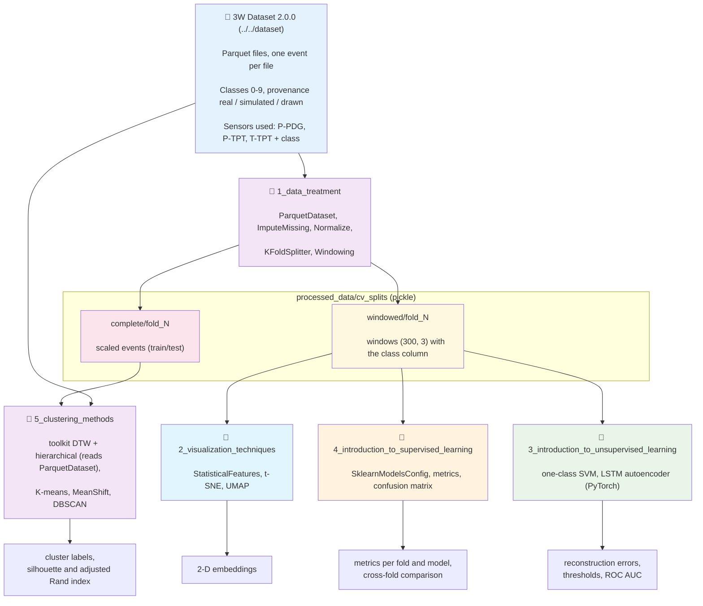

# Introduction to Machine Learning using the 3W Toolkit 3.2.1

## 🎯 Overview

This resource presents the **main Machine Learning concepts** through examples that use the **3W Toolkit 3.2.1** on the **3W Dataset**, a real-world dataset for fault detection in oil wells. Each notebook takes one concept (preparing and validating data, looking at the data, classifying, detecting anomalies, clustering) and shows it with the components of the toolkit; what the toolkit does not offer (yet) is added in `src/`, after the toolkit part, and is marked as such.

**Multivariate Time Series (MTS)** are time-ordered data with several variables measured simultaneously. In the 3W Dataset they are the sensor readings (pressure and temperature) of oil wells.

**🎓 Educational use**: the material is meant for classes, workshops and tutorials. It is taught in two classes within the 3W workshop (35 min and 1 h), after the toolkit minicourse; see [`Presentation.md`](Presentation.md), a speaker guide in Portuguese with the minute-by-minute plan, talking points, a demo checklist and fallbacks.

### What you will learn

| ML concept | Toolkit components used | Notebook |
|---|---|---|
| Data, provenance (real, simulated, drawn) and a first look at the series | `ParquetDataset`, `PlotMultipleSeries`, `CorrelationHeatmap` | 1 |
| Cleaning, scaling, validation without leakage, windowing | `ImputeMissing`, `Normalize`, `KFoldSplitter`, `Windowing` | 1 |
| Features and 2-D projections (a projection is a choice, not a measure) | `StatisticalFeatures` (t-SNE and UMAP are in `src/`) | 2 |
| Supervised classification, balanced accuracy, overfitting, why the sensor level identifies the well | `SklearnModelsConfig`, `metrics.*`, `AssessmentVisualization` | 4 |
| Anomaly detection with one-class models, thresholds, AUC | `metrics.accuracy_score`, `metrics.roc_auc_score` (the models are in scikit-learn and PyTorch) | 3 |
| Clustering of events and of windows, silhouette and adjusted Rand index | `clustering.*` (DTW, hierarchical), `DendrogramPlot` (K-means, MeanShift and DBSCAN are scikit-learn) | 5 |

The notebooks are numbered in the order of their dependencies: notebook 1 prepares the data that notebooks 2 to 5 read. In the classes the order is 1 and 2 (first class) and then 4, 3 and 5 (second class).

## 🎬 Classes and previous material

The two classes are part of the 3W workshop of November 2026 (18 and 19/11/26). The toolkit itself is presented before them, in the workshop minicourse, so the notebooks use it directly.

An earlier version of this material (written before the toolkit was adopted, with a TensorFlow autoencoder) was presented at the **4th Workshop on 3W** (Days 2 and 3) and recorded. **The recordings cover that earlier version**, so numbers and code differ from this resource:

- [▶ 4th Workshop recording, Part #1](https://www.youtube.com/watch?v=0ugu1piqtxc&list=PLrdqjADUU50kf0kjnM-JngcyU0mEFL6U1)
- [▶ 4th Workshop recording, Part #2](https://www.youtube.com/watch?v=o5KZyREfPKs&list=PLrdqjADUU50kf0kjnM-JngcyU0mEFL6U1)

The earlier resource is still available in [`../introduction_to_ml_applied_to_mts`](../introduction_to_ml_applied_to_mts/README.md).

## 📖 Companion Book

This resource is the practical companion of the book:

> Lopes, L. G. O.; Vieira, T. M. A.; Lima Junior, E. T.; Lira, W. W. M.; Aranha, P. E.; Vargas, R. E. V. (2026). **Aprendizado de Mundo Aberto em Poços de Petróleo: da detecção baseada em regras à explicabilidade por agentes de linguagem.** Maceió: Laboratório de Computação Científica e Visualização, Universidade Federal de Alagoas. ISBN 978-65-02-28836-8. DOI: [10.5281/zenodo.22306796](https://doi.org/10.5281/zenodo.22306796). Licensed under CC BY 4.0.

The book (in Portuguese) tells how the detection, segmentation and explanation of undesirable events in oil wells was attacked by successive approximations. **Appendix E** ("Roteiro prático com o repositório 3W") uses this resource as an executable learning path for the concepts of Part I, and each notebook points to the chapters that give its theoretical background:

| Notebook | Book chapters exercised |
|---|---|
| `1_data_treatment` | Ch. 3 — the 3W dataset, pitfalls, preprocessing (windowing, scaling) — and Ch. 4 — validation |
| `2_visualization_techniques` | Chs. 3 and 6 — t-SNE, UMAP and the caveats on projections |
| `3_introduction_to_unsupervised_learning` | Chs. 5, 6 and 7 — LSTM autoencoder, reconstruction-error threshold, one-class SVM |
| `4_introduction_to_supervised_learning` | Chs. 4 and 8 — trees, SVM, MLP and evaluation metrics |
| `5_clustering_methods` | Chs. 6 and 9 — K-means, DBSCAN, MeanShift, silhouette, adjusted Rand index |

**This resource is a learning path, not a reproduction of the book's experiments** (those are described in Appendix D). Its settings are reduced to fit the time of a class; the main differences are:

| Aspect | This resource | Book |
|---|---|---|
| Sensors | 3 (`P-PDG`, `P-TPT`, `T-TPT`) | 4 or 5, depending on the chapter |
| Window | 300 points, subsampled 1:5 (covers 1500 s) | 200 to 500 points at the original frequency |
| Instances per class | Up to 50 files | All available |
| Partition | 3 folds, split by instance; training with real + simulated (+ drawn) events, test with real events only | Temporal 80/20 split; simulated events only for classes with few real instances; drawn events never used |
| Scaling | Toolkit `Normalize`, fitted on the training events of each fold | Min-Max where the autoencoder has a sigmoid output; z-score for Mahalanobis |
| Autoencoder | 16 latent dimensions, 64 LSTM units | 4 to 128 latent dimensions, depending on the chapter |
| Classes | `[3, 4, 8]` (faults) in the supervised notebook; normal (0) against `[3, 4, 8]` in notebook 3 | All ten |

Each difference is a decision you can reverse by editing `src/config.py` and re-running. Every notebook ends with the guided exercises proposed in Appendix E. If you use this material, please cite the book (BibTeX at the end) and the [3W Project](../../README.md).

## 🧰 Relationship with the 3W Toolkit

The notebooks use the [3W Toolkit](../../toolkit/ThreeWToolkit/README.md) **3.2.1** (the version of this repository's `pyproject.toml`) and call it directly in the cells, toolkit first; what is done beyond it comes afterwards, as an extension.

| Used from `ThreeWToolkit` | Where |
|---|---|
| `dataset.ParquetDataset`, `ParquetDatasetConfig` — file discovery, provenance (`real`, `simulated`, `drawn`), class filter and reading | Notebooks 1 and 5 |
| `data_visualization.PlotMultipleSeries`, `CorrelationHeatmap` | Notebooks 1 and 2 |
| `preprocessing.ImputeMissing`, `preprocessing.Normalize` (default scaler, fitted on the training events of each fold) | Notebook 1 |
| `utils.KFoldSplitter` — K-fold over the real events, stratified by class | Notebook 1 |
| `feature_extraction.Windowing` — complete windows | Notebook 1 |
| `feature_extraction.StatisticalFeatures` | Notebook 2 |
| `models.SklearnModelsConfig` — the seven scikit-learn classifiers | Notebook 4 |
| `metrics.accuracy_score`, `balanced_accuracy_score`, `precision_score`, `recall_score`, `f1_score` | Notebooks 3 and 4 |
| `metrics.roc_auc_score` | Notebook 3 (inside the ROC panels of `src/visualization.py`) |
| `assessment.AssessmentVisualizationConfig` — confusion matrix | Notebook 4 |
| `clustering`: `InstanceQualityFilter`, `TimeSeriesResampler`, `TimeSeriesScaler`, `DistanceComputer` (DTW), `HierarchicalClusterer`; and `DendrogramPlot` | Notebook 5 |

What the toolkit does not offer stays in `src/`, on purpose:

| In `src/` or in the notebook | Toolkit counterpart | Why it stays |
|---|---|---|
| Cleaning and downsampling of each event, in-memory events, repacking of windows (`src/events.py`) | `preprocessing.ImputeMissing` (only fills gaps), `core.BaseDataset` | The toolkit cannot drop unlabeled rows or keep one row in `SAMPLING_RATE`; `Normalize.fit` needs a dataset; notebooks 2 to 5 read one dataframe per window |
| Scalers `standard`, `minmax`, `robust` (fitted per event) | — (`Normalize` only has L1/L2/max norms) | Alternatives to `Normalize`; comparing the four is exercise 1 of the book |
| Events with a sensor entirely missing | `preprocessing.ImputeMissing` | The toolkit raises an error; notebook 1 catches it (`try/except`) and skips the event |
| Class balancing (`src/data_augmentation.py`) | — | The toolkit has no resampling |
| t-SNE and UMAP | — | Not offered by the toolkit |
| One-class SVM | `models.SklearnModelsConfig` | The configuration rejects `OneClassSVM`, because the estimator has no `score` method required by the toolkit protocol; notebook 3 uses scikit-learn directly |
| LSTM autoencoder (PyTorch), reconstruction-error thresholds, ROC curve | `models.MLP`, `trainer.TorchTrainer` | The toolkit has no recurrent autoencoder, no anomaly detectors and no ROC curve (only `roc_auc_score`) |
| K-means, MeanShift, DBSCAN, Hungarian-matched accuracy | `clustering.*` | The toolkit clustering is DTW-based, on events |
| Flattening and balancing of the windows of notebook 4 (`src/supervised_classification.py`) and its comparison tables | `trainer.SklearnTrainer`, `assessment.ModelAssessment` | The toolkit trainers work on events, not on flattened windows, and have no model-comparison tables |
| `DataPersistence` | — | The toolkit only saves models (`ModelRecorder`) |

> **Fold policy:** notebook 1 uses `KFoldSplitter` on the **real** events only (so windows of one event never reach both sides) and then adds all the simulated events to each training fold: *train on real + simulated, test on real only*. The scaler is fitted on the training events of each fold only.

To go further with the toolkit, see its [demos](../../toolkit/demos/) (written for the 3.x line) and the [Introduction to 3WToolkit v2.0.0](../introduction_to_3w_toolkit_v2.0.0/README.md) tutorials (written for toolkit 2.0.0, so some names differ).

> **ℹ️ Versions**: the dataset is read by `ThreeWToolkit.dataset.ParquetDataset`, which expects the 3W Dataset **2.0.0** in `../../dataset/` (it is downloaded from Figshare when missing). The first cell of notebook 1 prints the installed toolkit version and warns when it differs from `EXPECTED_TOOLKIT_VERSION = "3.2.1"` in `src/config.py`.
>
> **Toolkit from this repository, not from PyPI**: the instructions install the toolkit in editable mode from this clone. The `3.2.1` published on PyPI (2026-06-19) is not identical to the code of this repository, which has the same version string: 10 files differ (documentation, imports, an error message, exports of `models`), and the published package has no `notebooks` extra. The resource was run only with the repository code; it was not tested with the PyPI package.

## 📊 Notebooks Architecture & Data Contracts



## 📋 Usage Instructions

### Prerequisites

- **Python ≥ 3.10** and [uv](https://docs.astral.sh/uv/) ([installation](https://docs.astral.sh/uv/getting-started/installation/)); no GPU is needed.
- **About 2.3 GB of RAM** at the peak (notebook 1, default settings).
- A clone of this repository: the notebooks read the dataset from `../../dataset/` and use the toolkit installed from the repository.

For the results to be **consistent**, use a virtual environment with the dependencies of the project's [pyproject.toml](../../pyproject.toml). From this folder (`resources/introduction_to_ml_using_3w_toolkit_v3.2.1`):

**Linux / macOS (terminal):**
```bash
uv venv .venv
source .venv/bin/activate
uv pip install -e "../../.[notebooks,resources]" jupyter
jupyter notebook
```

**Windows (cmd):**
```cmd
uv venv .venv
.venv\Scripts\activate.bat
uv pip install -e "../../.[notebooks,resources]" jupyter
jupyter notebook
```

**Windows (PowerShell):**
```powershell
uv venv .venv
.venv\Scripts\Activate.ps1
uv pip install -e "../../.[notebooks,resources]" jupyter
jupyter notebook
```

**Windows (Bash):**
```bash
uv venv .venv
source .venv/Scripts/activate
uv pip install -e "../../.[notebooks,resources]" jupyter
jupyter notebook
```

Then check the toolkit version (expected `3.2.1`):
```bash
python -c "import ThreeWToolkit; print(ThreeWToolkit.__version__)"
```

> **📋 Environment notes**
> - The dependencies are managed by the project's `pyproject.toml`. The extras used above are `notebooks` (Jupyter kernel and `nbconvert`) and `resources` (`umap-learn`, needed by notebook 2). `jupyter` provides `jupyter notebook` / `jupyter lab`; you can also open the notebooks in VS Code. See the toolkit's [installation guide](../introduction_to_3w_toolkit_v2.0.0/2_installation.ipynb) for other installation methods.
> - The LSTM autoencoder of notebook 3 is written in PyTorch, which is already a dependency of the toolkit.
> - The 3W Dataset 2.0.0 is expected in `../../dataset/`; if it is missing, `ParquetDataset` downloads it from Figshare on first use (the download is large: do it before a class).

### Execution Order

1. Run `1_data_treatment.ipynb` first: it saves `processed_data/`, which notebooks 2 to 5 read (the first block of notebook 5 reads the dataset directly).
2. Run the others in any order. In the classes: 1 and 2, then 4, 3 and 5.
3. Change `src/config.py` to try other parameters, and run notebook 1 again.

| Notebook | Time (CPU, 8 threads) | Peak memory |
|---|---|---|
| 1 `1_data_treatment` | ≈ 1 min | 2.3 GB |
| 2 `2_visualization_techniques` | ≈ 1 min | 1.1 GB |
| 3 `3_introduction_to_unsupervised_learning` | 4–5 min | 0.9 GB |
| 4 `4_introduction_to_supervised_learning` | 2–3 min | 1.9 GB |
| 5 `5_clustering_methods` | < 1 min | 1.9 GB |

All five take about 8 to 10 minutes (measured with the default configuration, on CPU; the times vary with the load of the machine, and the first run also reads the dataset from disk, which is slower). `MAX_FILES_PER_CLASS` is the first parameter to reduce if notebook 1 runs out of memory.

### Quick Start

```python
# Verify that notebook 1 has saved its data
from src import config
from src.data_persistence import DataPersistence

persistence = DataPersistence(base_dir=config.PROCESSED_DATA_DIR, verbose=False)
print(persistence.get_save_summary())  # {'total_files': 13, 'total_size_mb': ...}
```

## 🔧 Configuration

All pipeline parameters are centralized in `src/config.py`. The names of the windowing and scaling parameters follow the toolkit steps they feed:

```python
EXPECTED_TOOLKIT_VERSION = "3.2.1"
TARGET_FEATURES = ["P-PDG", "P-TPT", "T-TPT", "class"]
NON_REAL_EVENT_TYPES = ["simulated", "drawn"]  # loaded after the real events, up to MAX_FILES_PER_CLASS
MAX_FILES_PER_CLASS = 50
SAMPLING_RATE = 5            # keeps one row in five: a 300-point window covers 1500 s
WINDOW_SIZE = 300            # `window_size` of the toolkit Windowing
WINDOW_OVERLAP = 0.5         # `overlap` of Windowing: windows 150 samples apart
N_FOLDS = 3                  # `num_splits` of KFoldSplitter
DEFAULT_SCALING_METHOD = "normalizer"  # toolkit Normalize; or "standard", "minmax", "robust"
NORMALIZE_NORM = "l2"        # dispersion of Normalize: "l1", "l2" (z-score) or "max"
RANDOM_SEED = 42
```

Other parameters: `ENABLE_DATA_SAMPLING` and `SAMPLING_METHOD` (how rows are downsampled), `CV_RANDOM_STATE`, `PROCESSED_DATA_DIR`, `MAX_NORMAL_SAMPLES` and `MAX_ANOMALY_SAMPLES` (windows per fold in notebook 3), `SELECTED_ANOMALY_CLASSES` (`[3, 4, 8]`), `VISUALIZATION_MAX_SAMPLES` and the `TSNE_CONFIGS` and `UMAP_CONFIGS` of notebook 2.

> **Three parameters change the nature of the experiment** (see Appendix E of the [companion book](#-companion-book)): `SAMPLING_RATE` (compare with the book by the *time covered* by a window, not by its number of points), `WINDOW_OVERLAP` (overlapping windows are harmless here only because folds are split by event, not by window) and `NON_REAL_EVENT_TYPES` (use `["simulated"]` to exclude hand-drawn events, closer to the book's protocol).

## 📈 Expected Outputs

Results with the default configuration and `RANDOM_SEED = 42`, on the same dataset and toolkit version. They are **indicative**, not benchmarks:

| Notebook | What it shows |
|---|---|
| 1 | 400 events kept (235 real, 165 simulated/drawn; 84 discarded because a sensor is entirely missing); 3 folds; 85,092 windows (69,128 for training and 15,964 for test, summed over the folds) |
| 2 | 30 `StatisticalFeatures` against the 900 values of a flattened window; four t-SNE and four UMAP configurations that tell different stories |
| 3 | One-class SVM: mean overall accuracy 0.926 over 3 folds. LSTM autoencoder: 0.964, with an AUC close to 1.0 that is explained by the absolute sensor levels kept by `Normalize` (the notebook shows the comparison with the per-event Min-Max) |
| 4 | Mean test accuracy over 3 folds: simple MLP 0.976, regularized MLP 0.975, deep MLP 0.970, RBF SVM 0.968, random forest 0.963, decision tree 0.944, linear SVM 0.919 (the least consistent). The sensor level identifies the well in about 96 % of the windows with `Normalize` (57 % with a per-event Min-Max), and balanced accuracy falls from about 0.90 (folds by event) to about 0.30 (folds by well); a small sample, so only an indication |
| 5 | Toolkit DTW + hierarchical clustering of 39 real events (low agreement with the classes, which is expected: the goal is to select events). K-means: K = 6 for 3 classes, silhouette 0.738, adjusted Rand index 0.503. MeanShift: 11 clusters in PCA 50D (silhouette 0.679, adjusted Rand index 0.535) and 12 on the normalized data (0.755 and 0.522). DBSCAN, with the radius chosen by the silhouette: 4 clusters and 9 noise points on the normalized data (adjusted Rand index 0.523) and 5 clusters and 5 noise points in PCA 50D (0.516). The groups are compact, but none of the methods recovers the 3 classes (adjusted Rand index about 0.5); one very different event (class 8) sits far from all the others in the PCA plot. A table before the advanced section puts them side by side with the accuracy of the best class-to-cluster matching: 0.70 for all six (K-means with K = 3 gets 0.82; a constant label gets 0.35) |

After notebook 1, `processed_data/` (ignored by git) holds:

```
processed_data/
├── cv_splits/
│   ├── complete/            # scaled events
│   │   └── fold_1/ ... fold_3/   (train_data.pickle, test_data.pickle)
│   └── windowed/            # windows (300 rows, sensors + class)
│       └── fold_1/ ... fold_3/   (train_windowed.pickle, test_windowed.pickle)
└── metadata/
    └── processing_summary.json
```

Each pickle holds `{"dataframes": [...], "classes": [...]}`.

## 📚 Notebook Description

### 1️⃣ `1_data_treatment.ipynb` — events, scaling, folds and windows
- Opens the events with `ParquetDataset` (counts per provenance, one event plotted with `PlotMultipleSeries` and `CorrelationHeatmap`), chooses up to `MAX_FILES_PER_CLASS` events per class (real first) and cleans them (`src/events.py`).
- Compares the toolkit `Normalize` with the scikit-learn scalers on one event.
- Splits the real events with `KFoldSplitter`, builds the folds (training with real + simulated, test with real), scales each fold with the statistics of its training events (`ImputeMissing` under `try/except`, then `Normalize`).
- Windows every event with `Windowing`, and saves everything to `processed_data/`.

### 2️⃣ `2_visualization_techniques.ipynb` — features and projections
- Plots sample windows of each class; compares the 30 `StatisticalFeatures` with the flattened window as the input of a t-SNE.
- Runs four t-SNE and four UMAP configurations and compares them: *a projection is a choice, not a measure*.

### 3️⃣ `3_introduction_to_unsupervised_learning.ipynb` — anomaly detection
- Trains on normal windows only (class 0) and tests on normal windows and anomalies of classes 3, 4 and 8, fold by fold.
- One-class SVM (scikit-learn `OneClassSVM` in a pipeline), then the PyTorch LSTM autoencoder (`StableLSTMAutoencoder`): reconstruction error, 95th-percentile and mean + 2σ thresholds, ROC curve and AUC, latent space; a warning on why the AUC is almost perfect.

### 4️⃣ `4_introduction_to_supervised_learning.ipynb` — classification
- One random forest end to end with the toolkit (`SklearnModelsConfig`, metrics, confusion matrix).
- Seven models (decision tree, random forest, linear and RBF SVM, three MLPs) in one loop, fold by fold, with accuracy, balanced accuracy, overfitting and a cross-fold consistency comparison.
- A section on why the sensor level identifies the well, and what that does to the validation.

### 5️⃣ `5_clustering_methods.ipynb` — clustering
- Toolkit first: quality filter, resampling, DTW distances, hierarchical clustering and dendrogram on 15 real events per class (`P-TPT`).
- Then K-means (elbow and silhouette), MeanShift and DBSCAN on the series resized to 500 points, scored with silhouette, adjusted Rand index and Hungarian-matched accuracy.

## 🗂️ Structure of `src/`

| Module | Content |
|---|---|
| `config.py` | Parameters of the whole pipeline |
| `events.py` | Cleaning and downsampling of an event, in-memory events for `Normalize.fit`, repacking of windows |
| `data_persistence.py` | Saves and reads the folds shared by the notebooks |
| `data_augmentation.py` | Class balancing (undersampling, oversampling, combined) |
| `visualization.py` | Dataset overview, t-SNE and UMAP projections, panels of the anomaly detectors |
| `unsupervised_preprocessing.py` | Per-fold loader of normal and anomaly windows (notebook 3) |
| `autoencoder_models.py` | LSTM autoencoder in PyTorch |
| `anomaly_detection.py` | Reconstruction errors, thresholds and detection metrics |
| `supervised_classification.py` | Loader and preparation of the windows of notebook 4 |
| `clustering_utils.py` | K-means, MeanShift, DBSCAN and Gaussian mixture analyses, Hungarian-matched accuracy |
| `clustering_visualization.py` | Plots of the clustering analyses |

## 📝 Notes

- **Reproducibility**: random seeds are fixed (`RANDOM_SEED = 42`), including the window sampling of notebook 3, so repeated runs give the same numbers on the same dataset and package versions. Across machines the last digits can vary.
- **Data dependency**: notebooks 2 to 5 need `processed_data/` from notebook 1.
- **Results and the book**: do not compare the numbers with those of the book; windows, sensors, latent space and partition differ (table above).

## 📚 Citation

If you use this material, please cite the book and the 3W Project:

```bibtex
@book{lopes2026mundoaberto,
  author    = {Lopes, Lucas Gouveia Omena and Vieira, Thales Miranda de Almeida and Lima Junior, Eduardo Toledo de and Lira, William Wagner Matos and Aranha, Pedro Esteves and Vargas, Ricardo Emanuel Vaz},
  title     = {Aprendizado de Mundo Aberto em Po{\c{c}}os de Petr{\'o}leo: da detec{\c{c}}{\~a}o baseada em regras {\`a} explicabilidade por agentes de linguagem},
  year      = {2026},
  publisher = {Laborat{\'o}rio de Computa{\c{c}}{\~a}o Cient{\'i}fica e Visualiza{\c{c}}{\~a}o, Universidade Federal de Alagoas},
  address   = {Macei{\'o}},
  isbn      = {978-65-02-28836-8},
  doi       = {10.5281/zenodo.22306796}
}
```

See also the [3W Project](../../README.md) and its [citation file](../../CITATION.md).
